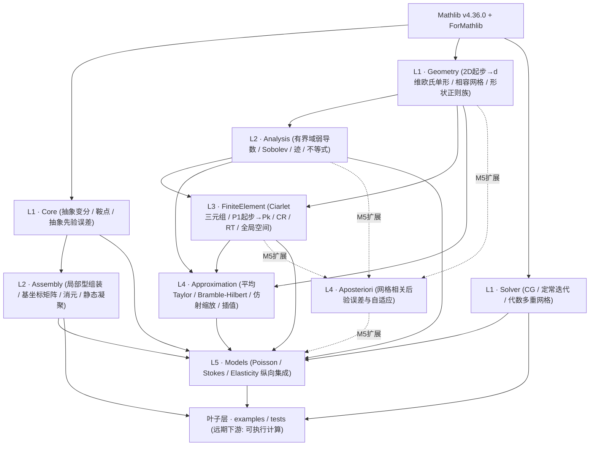

# FemLean 整体架构与分模块规划框架（最终修订版）

本规划按数学依赖组织 Braess《*Finite Elements*》（第 3 版）中的结果。首个完整目标是二维 Poisson 问题从协调 $P_1$ 离散、矩阵装配到误差估计的形式化。模块依赖见[项目架构](docs/zh-CN/architecture.md)，里程碑见[路线图](docs/zh-CN/roadmap.md)，待选的 Lean 表示及其审查状态见 [RFC 索引](docs/zh-CN/rfcs/README.md)。

---

## 一、已确认的 6 条总体原则

1. **按数学依赖正交分层，不按教材章节编排**：变分理论不碰几何；几何网格不碰 PDE；有限元不绑定具体方程；代数求解器不依赖网格单元实现。
2. **精简为 8 个核心主干层 + 1 个 M5 按需扩展层（`Aposteriori/`）**：
   - 将 `Assembly/` 提升为独立一级主干层（连接离散变分与有限维矩阵求解器）；
   - 将原易产生先验/后验歧义的 `Error/` 更名为 **`Aposteriori/`**，明确仅在 M5 按需创建，避免 M1–M4 长期空置；
   - 将可执行数值后端 `Computation` 移出核心理论库目录树，保留为远期下游扩展方向。
3. **优先复用 Mathlib `v4.36.0` 原生设施，用 `ForMathlib/` 承接通用补丁**：在 RFC 0001 / 0002 起步阶段即评估复用 Mathlib 2025–2026 新合入的 `Analysis.Distribution.TestFunction` / `Distribution` 与 `Geometry.Euclidean.Simplex` / `Volume.MeasureSimplex` / `Incenter` 等基础设施；缺失的通用小引理统一放进 `FemLean/ForMathlib/` 以便追踪上游贡献。
4. **明确范围边界（砍掉教材第 I 章，正则性显式条件化）**：
   - 古典 PDE 极值原理与有限差分方法（Braess 第 I 章）**不纳入** `FemLean` 核心库；
   - M4 假设当前弱解属于 $H^2(\Omega)$。对所有载荷的椭圆正则性估计可作为独立结果供后续定理调用。
5. **2D 优先落地，再做高维泛化（规避 demo 的 2D 硬伤）**：
   - M2–M4 先集中打通 **2D 三角形 $P_1$ 有限元**完整端到端收敛链路；
   - 从一开始即采用欧氏空间 `EuclideanSpace ℝ (Fin 2)`（避免 `ℝ × ℝ` 最大范数与欧氏坐标双轨转换），并显式解耦固定区域覆盖（避免 `H10 M.domain` 导致的 `hΩ ▸` 依赖类型替换），让后续 `Fin 2 → Fin d` 泛化平滑过渡。
6. **M1 坚持最小闭环，其余模块按需渐进扩展**：M1 只完成无网格、无具体 PDE 的抽象 Galerkin 最小闭环（有界/强制双线性型 → 弱解与 Galerkin 解 → Galerkin 正交性 → Céa 引理 → 全空间精确性与编译示例），Lax–Milgram、能量极小化、装配、Aubin–Nitsche、Strang、鞍点与求解器分阶段逐步接入。

---

## 二、总体分层架构与依赖有向图（8 核心层 + 1 扩展层）



> [!IMPORTANT]
> **导入单向红线**：
> - `Core` 可依赖 Mathlib、`ForMathlib` 中的通用引理及其他 `Core` 模块。`ForMathlib` 只依赖 Mathlib 和本目录的通用引理。
> - `Geometry` 不依赖 PDE 或 Galerkin 方法；
> - `Analysis` 可使用 `Geometry` 中的欧氏空间与测度工具，但不依赖网格或有限元；
> - `Assembly` 只依赖 `Core` 与线性代数接口，不依赖具体三角形实现或 PDE 模型；
> - `Solver` 只依赖矩阵/算子与正定性或谱条件，不依赖网格或单元实现；
> - `FiniteElement`、`Approximation`、`Aposteriori` 不得导入 `Models`；
> - `examples/`、`tests/` 为叶子层，核心库模块严禁导入它们或根文件 `FemLean.lean`。

---

## 三、模块目录与职责划分

```text
FemLean/
├── Core/                 # [主干1] 抽象变分、鞍点与模型无关先验误差（Céa / Aubin–Nitsche / Strang / Brezzi）
├── Geometry/             # [主干2] 欧氏单形（2D 起步→d 维）、相容网格与形状正则网格族
├── Analysis/             # [主干3] 有界域弱导数、Sobolev 空间（H¹, H¹₀, H², 后续扩展向量值与 H(div)）、不等式与正则性接口
├── FiniteElement/        # [主干4] 抽象 Ciarlet 三元组 (K, P, Σ)、参考/物理映射、具体单元（2D P₁ 起步）与全局空间
├── Approximation/        # [主干5] 多项式再现、平均 Taylor / Bramble–Hilbert、仿射缩放与插值误差
├── Assembly/             # [主干6] 局部型组装、基坐标刚度矩阵/载荷向量、本质边界消元与静态凝聚
├── Solver/               # [主干7] Krylov 方法（CG）、Uzawa 鞍点迭代与多重网格
├── Models/               # [主干8] 具体 PDE 模型的纵向切片集成（Poisson / Stokes / Elasticity）
├── Aposteriori/          # [M5按需扩展] 网格相关后验误差估计（残差型、平衡通量 / Prager–Synge）与自适应
└── ForMathlib/           # [上游补丁] 拟向上游 Mathlib 贡献的通用小引理

examples/                 # 叶子目录：教学与验收算例（中心扇形、单位正方形等）
tests/                    # 叶子目录：Smoke 测试、退化/反例检查、公理审计
```

> **渐进原则**：只创建当前里程碑真正需要的目录和文件；可执行数值后端（`Computation`）留在核心理论库之外，待 M4 之后按独立下游包或实验目录评估。

---

## 四、Mathlib `v4.36.0` 实查可复用清单与自建边界

以下逐模块对照**已实测核对的本地 Mathlib `v4.36.0` 模块**，明确“直接复用什么”与“FemLean 必须自建什么”，避免重复造轮子：

| FemLean 模块 | Mathlib `v4.36.0` 已具备（直接复用 / 优先评估包装） | FemLean 自建核心内容 |
| --- | --- | --- |
| **`Core/`** | • `Analysis.InnerProductSpace.Dual`（Riesz 表示）<br>• `Analysis.InnerProductSpace.LaxMilgram`（`IsCoercive.continuousLinearEquivOfBilin`）<br>• `Analysis.InnerProductSpace.Projection.*`（闭子空间正交投影）<br>• `Analysis.Normed.Operator.Bilinear`（连续双线性算子范数） | 显式常数谓词 `BoundedBy` / `CoerciveWith`、弱解与 Galerkin 解、Galerkin 正交、Céa 引理（支持 $0 \le M$）、闭凸集二次能量极小化、Aubin–Nitsche、Strang I/II、Babuška–Brezzi 鞍点理论与 Fortin 判据 |
| **`Geometry/`** | • `LinearAlgebra.AffineSpace.Simplex.Basic`（任意维 `Affine.Simplex ℝ P n` 与二维 `Affine.Triangle`）<br>• `Geometry.Euclidean.Simplex` / `Triangle` / `Incenter.Basic`（欧氏单形、三角形与内心）<br>• `Geometry.Euclidean.Volume.MeasureSimplex`（单形代数体积 = 闭内部测度）<br>• `MeasureTheory.Measure.Haar.*`（仿射测度换元） | 相容网格（跨单元公共面条件）、固定区域覆盖接口（免 `Eq.rec`）、边界刻画、网格尺度 $h_T/h$、形状正则族（$\rho_T \ge h_T/\kappa$）与参考到物理仿射矩阵算子范数缩放界 |
| **`Analysis/`** | • `Analysis.Distribution.TestFunction`（紧支撑光滑测试函数 `𝓓(Ω, F)`）<br>• `Analysis.Distribution.Distribution`（广义函数 `𝓓'(Ω, F)`）与 `AEEqOfIntegralContDiff`（变分基本引理）<br>• `Analysis.Calculus.BumpFunction.{Convolution, SmoothApprox}`（磨光与光滑逼近）<br>• `Analysis.Calculus.LineDeriv.IntegrationByParts` 与 `MeasureTheory.Integral.DivergenceTheorem`（分部积分与散度定理）<br>• 注：`Analysis.Distribution.Sobolev`（全空间 Fourier 版）与 `Analysis.FunctionalSpaces.SobolevInequality`（$C_c^1$ 嵌入）暂不能直接替代有界域 $H^1(\Omega)$ | 有界区域上的弱导数 Sobolev 空间（bundled $H^1(\Omega)$、图闭包 $H_0^1(\Omega)$、$H^2(\Omega)$、$H(\operatorname{div})$ 及向量值 $H^1(\Omega; \mathbb{R}^d)$）、有界域 Poincaré/Friedrichs、边界迹与零迹、弱导数仿射拉回、Korn 不等式、椭圆正则性接口 |
| **`FiniteElement/`** | • `Algebra.MvPolynomial`、`AffineMap`、`LinearAlgebra.Lagrange`（一维单变量多项式插值） | Ciarlet 有限元三元组 $(K, P, \Sigma)$、单值性线性等价、2D $P_1$（及后续 $P_k/Q_k$/CR/RT/Taylor–Hood）、Piola 变换、分片拼接与全局协调嵌入 |
| **`Approximation/`** | • `Analysis.Calculus.TaylorIntegral`、`Analysis.Calculus.Taylor`（Taylor 积分余项） | 平均 Taylor 多项式（Dupont–Scott）、Bramble–Hilbert 引理、参考元误差界、仿射拉回半范数缩放、全局节点/Clément 插值误差分解、逆估计 |
| **`Assembly/`** | `LinearAlgebra.Matrix.PosDef`、`SchurComplement`、`BilinearForm`。`Matrix.PosDef.conjTranspose_mul_mul_same` 用于沿单射的合同变换。`Matrix.PosDef.fromBlocks₁₁` 在主块可逆且正定时刻画分块矩阵与 Schur 补的**半正定性**。 | 单元 `gather`/`scatter`、测试行和试探列的坐标等价、边界消元与静态凝聚解恢复。具体 Poisson 矩阵的正定性由 `Models/Poisson` 实例化。 |
| **`Solver/`** | • `Analysis.InnerProductSpace.Spectrum`（有限维自伴算子谱定理）、`Matrix.PosDef` | 定常迭代、CG 与 Chebyshev 条件数界、Uzawa 鞍点迭代、Galerkin 粗网格修正与多重网格两网格/V-W 循环收敛 |
| **`Aposteriori/` & `Models/`** | 无直接对应（由上面 7 层与 Mathlib 组合构建） | 残差型与平衡通量后验估计（Prager–Synge）；Poisson / Stokes / 3D 线弹性纵向建模与端到端误差定理 |

> **`ForMathlib/` 职责**：当包装 Mathlib 的 `TestFunction`、`Affine.Simplex` 或 `Matrix.PosDef` 时，若缺少本应属于 Mathlib 的通用引理（例如单形仿射映射的局部测度/导数辅助引理），统一沉淀到 `FemLean/ForMathlib/`，保持主模块整洁并便于向上游 Mathlib 贡献。

---

## 五、对 `BraessFEM`（demo）的借鉴与取舍矩阵

`BraessFEM` 以 `1a8c570` 为只读参考版本。

| 策略 | 对应 `BraessFEM` 内容 | 在 `FemLean` 中的落位与改造要点 |
| --- | --- | --- |
| **直接借鉴证明结构（低成本）** | `Variational/*`（6 文件）<br>`Assembly/*`（5 文件）<br>`Multigrid/CoarseCorrection` | 按 `fem-lean` 人工审核过的陈述重写；M1 先迁最小闭环（弱解、Galerkin、正交性、Céa，支持 $0 \le M$），M2/M3/M5/M6 再按需引入 Lax–Milgram、能量极小、Aubin–Nitsche、Strang、装配与粗网格修正 |
| **复用数学路线，升级接口** | `Analysis/DirichletSpace`, `SobolevAffine`, `AveragedTaylor`, `SobolevDensity`, `DirichletTrace`<br>`Mesh/TriangularMesh`, `ShapeRegular`<br>`Elasticity/*` | 先落地 2D，但从底层换用 `EuclideanSpace ℝ (Fin 2)`（去掉 `Point2 := ℝ × ℝ` 双度量割裂）、优先评估对接 Mathlib 的 `TestFunction` 与 `Affine.Simplex`、补齐 bundled `H1`、解耦固定域覆盖（去掉 `hΩ ▸`）、抽象 Ciarlet 三元组 |
| **留在参考库** | `FiniteDifference/*`、`Analysis/ClassicalPoisson`、`Examples/TwoTriangle*`、`Analysis/SublevelDivergence` | 第 I 章差分与古典最大值原理在核心范围之外。算例移植时使用叶子目录和共用网格接口。凸域正则性证明可按下游需求引入。 |

在该冻结版本中，`Analysis/SublevelDivergence` 已证明 `integral_divergence_nonneg_of_boundaryFlux`，且 `Analysis/SmoothConvexHessianEstimate` 调用了该定理。M4 直接使用当前解的 $H^2$ 假设。

---

## 六、Braess《Finite Elements》（第 3 版）到模块的映射

| 教材位置 | 核心内容 | 对应 `FemLean` 模块 | 阶段 |
| --- | --- | --- | --- |
| Ch. I §§1–4 | 古典椭圆 PDE、五点差分与离散极值原理 | *不纳入核心库* | 排除 |
| Ch. II §4 | Ritz–Galerkin、Galerkin 正交、Céa 引理 | `Core/` | **M1（最小闭环）** |
| Ch. II §§1–3 | Sobolev 空间、Lax–Milgram、Poincaré、边值问题 | `Core/` + `Analysis/` + `Models/Poisson/` | **M2（2D 起步）** |
| Ch. II §5, §8 | 2D 可容许三角网格、Ciarlet 三元组、$P_1$ 协调空间、装配与消元 | `Geometry/` + `FiniteElement/` + `Assembly/` + `Models/Poisson/` | **M3（2D $P_1$ + 装配）** |
| Ch. II §§6–7 | 平均 Taylor / Bramble–Hilbert、插值估计与一阶 $H^1$ 误差 | `Approximation/` + `Models/Poisson/` | **M4** |
| Ch. II §7 | Aubin–Nitsche 对偶论证与 $L^2$ 误差 | `Core/` + `Models/Poisson/` | **M5** |
| Ch. III §§1–9 | Strang I/II、CR 非协调、鞍点/inf-sup/RT/Stokes、后验估计 + 高维与高阶 $P_k$ 泛化 | `Core/` + `FiniteElement/` + `Aposteriori/` + `Models/Stokes/` | **M5（按需扩展与泛化）** |
| Ch. IV–VI | CG、多重网格（两网格/V-W 循环）、3D 线弹性/Korn/锁死与板壳 | `Solver/` + `Analysis/` + `Models/Elasticity/` | **M6（求解器与弹性）** |

---

## 七、RFC 序列与分阶段里程碑

### 4 份核心 RFC

1. **[RFC 0003](docs/zh-CN/rfcs/0003-bilinear-form-interface.md)（M1，已并入 `main` 基础并推进中）**：有界性与强制性双线性型接口（`BoundedBy` / `CoerciveWith`）。
2. **[RFC 0001](docs/zh-CN/rfcs/0001-sobolev-representation.md)（M2）**：Sobolev 空间表示——2D 优先落地（`EuclideanSpace ℝ (Fin 2)`），评估对接 Mathlib 的 `Distribution.TestFunction` / `Distribution` / `AEEqOfIntegralContDiff` 与外部 `EllipticPDE`，并为后续 `Fin d` 与向量值空间留出扩展通道。
3. **[RFC 0002](docs/zh-CN/rfcs/0002-mesh-representation.md)（M3）**：网格表示——2D 三角形相容网格与形状正则族优先，评估包装 Mathlib 的 `Affine.Simplex` / `Geometry.Euclidean.Volume.MeasureSimplex` / `Incenter`，显式绑定固定区域覆盖以避免 `Eq.rec`，且不阻塞 $d$ 维单形泛化。
4. **[RFC 0004](docs/zh-CN/rfcs/0004-finite-element-interface.md)（M3，草稿）**：有限元接口——抽象 Ciarlet 三元组 $(K, P, \Sigma)$、单值性、参考映射（先仿射 $P_1$，预留高阶 $P_k$/非协调/Piola 变换）与全局协调空间嵌入。

### 分阶段里程碑（M0 → M6）

| 阶段 | 核心交付范围 |
| --- | --- |
| **M0 · 基础设施**（已完成） | 固定 Lean/Mathlib 4.36.0、CI + `axiom-audit`、蓝图、文档、协作模板 |
| **M1 · 抽象变分最小闭环**（进行中） | `BoundedBy` / `CoerciveWith`（已完成）、`IsWeakSolution` / `IsGalerkinSolution` / `galerkin_orthogonality`（PR 分支进行中）、`cea`（支持 $0 \le M$）、整空间精确性推论、编译示例与蓝图链接 |
| **M2 · 2D Poisson 连续问题** | RFC 0001 定稿；复用 Mathlib Lax–Milgram，建立 2D 有界域 Sobolev 核心（$H^1 / H^1_0$、Poincaré/Friedrichs）；实例化 Poisson 弱问题并推出抽象 Galerkin 拟最优性 |
| **M3 · 2D $P_1$ 有限元与装配桥梁** | 固定域网格、Ciarlet 单元、任意节点值与边界零节点值的重建。`Assembly/` 给出坐标等价，`Models/Poisson` 得到消元系统及其正定性。 |
| **M4 · 第一条端到端 2D 有限元误差定理** | 边界保持的逼近估计、Galerkin 解及消元矩阵解重建的一阶 $H^1$ 误差。 |
| **M5 · 方法扩展与高维泛化** | 按研究需求推进：Aubin–Nitsche $L^2$ 对偶误差、Strang I/II 与 CR 非协调元、鞍点 inf-sup / Fortin / RT / Stokes、高阶 $P_k$、`Assembly/` 静态凝聚（复用 Mathlib `Matrix.SchurComplement`）、`Aposteriori/` 后验估计，以及从 2D 向 $d$ 维单形与 Sobolev 空间的泛化 |
| **M6 · 快速求解器与线弹性** | `Solver/`（CG 误差界、多重网格粗网格修正与两网格/V-cycle 收敛，可在 `Assembly/` 矩阵接口就绪后并行启动）与 `Models/Elasticity/`（3D 向量 Sobolev、应变与材料能、Korn 不等式、无锁死混合方法） |

### M2–M4 的共同验收算例

固定开单位正方形 $\Omega$。沿对角线剖分与从中心连向四角的剖分都应满足：闭三角形之并是 $\overline\Omega$，其内部是 $\Omega$，只属于一个单元的闭边之并是 $\partial\Omega$。两张网格的全体节点值均重建到 $H^1(\Omega)$。对内部顶点坐标 $D_h^0$ 在边界补零，所得线性单射 $R_h^0:D_h^0\hookrightarrow H_0^1(\Omega)$ 的像才是齐次 Dirichlet 离散空间。

对于试探基 $\phi_j$ 和测试基 $\psi_i$，装配约定为 $K_{ij}=a(\phi_j,\psi_i)$。当 $a(x,y)=x_1y_2$，平面标准基给出 $K_{21}=1$、$K_{12}=0$。单位正方形中心剖分有一个自由顶点；对于 $-\Delta u=1$，消元方程为 $4U_c=1/3$。前一例检验行列方向，后一例检验 Poisson 方程与非零离散空间的对应。

M4 对一般固定的有界 Lipschitz 多边形域 $\Omega$ 及统一形状正则界 $\kappa$ 取同一常数 $C=C(\Omega,\kappa)$。设 $u\in H^2(\Omega)\cap H_0^1(\Omega)$ 为单位系数 Poisson 弱解，$h$ 为最大单元直径。对族中任一网格及消元方程 $K_0 U=F_0$ 的解，验收结论为

$$
\lVert u-R_h^0 U\rVert_{H^1(\Omega)}
\le C h\,\lvert u\rvert_{H^2(\Omega)}.
$$
